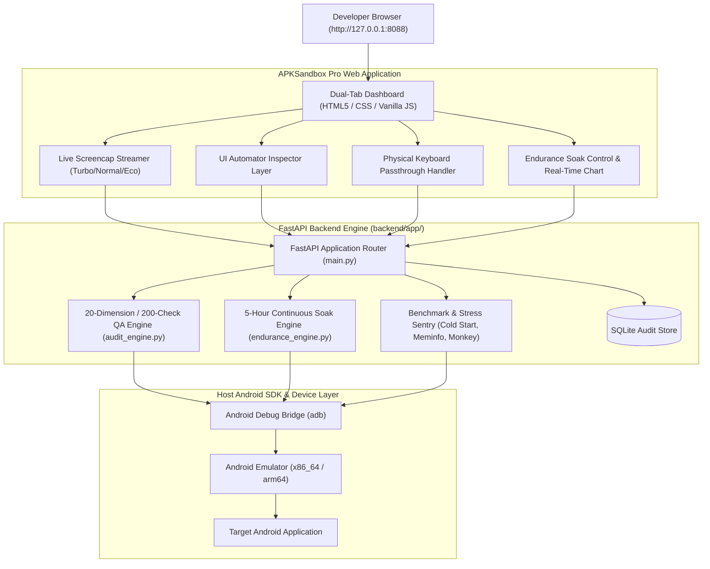

# APKSandbox Pro 📱🧪

> **Advanced Interactive Android Simulator & Automated 200-Check QA Laboratory**  
> Local, deterministic, high-fidelity Android testing and execution suite combining the interactivity of BrowserStack/Appetize.io, the security analysis of MobSF, and the automated stress testing of Firebase Test Lab.

---

## ✨ Highlights

* **📱 Live Interactive Phone Simulator in Your Browser**:
  * **Adaptive Screen Streaming**: Switch between **Turbo (200ms)**, **Normal (450ms)**, and **Eco (900ms)** with real-time FPS counter.
  * **True Physical Keyboard Passthrough**: Type directly inside Android apps using your computer's physical keyboard without auxiliary inputs.
  * **Touch & Momentum Gestures**: Exact coordinate tap, swipe, and vertical fling scroll.
  * **Hardware Bezel & System Controls**: Back (◀), Home (⚪), Recents/App Switcher (▢), Power/Lock, Volume Up/Down, HTML5 Fullscreen mode, and 3-stage bezel scale (650px / 760px / 860px).
  * **Drag & Drop Media Pusher**: Drop images, audio, or files directly onto the phone screen to push to `/sdcard/Download/` and notify Android Media Scanner.
  * **Multitasking App Switcher**: Switch on the fly between target apps, Google Messages, Chrome, Device Settings, and Android Home.

* **⏳ Continuous 5-Hour Endurance & Soak Testing Engine**:
  * **Autonomous Long-Running Stress & Burn-In**: Configurable testing sessions up to **5 continuous hours (300 minutes)** with stochastic user interactions.
  * **Time-Series Telemetry & Memory Leak Detection**: Automatic linear regression slope calculation ($\text{MB/hr}$) detecting progressive memory leaks, GC thrashing, and native heap growth.
  * **Power & Thermal Sentry**: Tracks battery drain rate ($\%\text{/hr}$) and thermal temperature profiles (`dumpsys battery`).
  * **Live Real-Time Telemetry Charting**: Dynamic canvas rendering tracking PSS RAM, Native Heap, and CPU Load curves over the duration of the test.
  * **Full Session Control**: Dedicated Start, Pause, Resume, and Stop controls with automated final endurance diagnostic reports.

* **🧪 20 Autonomous Parallel Testers & 200-Check QA Audit Matrix**:
  * **200 Granular Sub-Tests** (exactly 10 checks per dimension) evaluated via deep static bytecode analysis, manifest parsing, and live device ADB execution.
  * **Configurable Concurrency**: Scale execution across **1 to 20 parallel worker threads**.
  * **OWASP Mobile Top 10** mapping (M1–M10) on every security, cryptographic, and storage check.
  * Granular status (`passed`, `warning`, `failed`), severity grading (`Critical`, `High`, `Medium`, `Low`, `Info`), and remediation guidance.
  * Dimensions audited:
    1. **Installation & Package Lifecycle** (4-byte zipalign, v1/v2/v3 signing, SDK 35 compliance, install lifecycle)
    2. **UI, Layout & Theming** (Adaptive icons, 5 density buckets, dark mode styles, RTL support, 48dp touch targets)
    3. **Navigation & Deep Linking** (Launcher entrypoints, unprotected exported activities, intent filters, backstack)
    4. **Functional & Component Architecture** (Services, receivers, providers, foreground execution limits)
    5. **Input Surface & Validation** (URI scheme sanitization, MIME types, content provider traversal, IME flags)
    6. **Performance & Resource Footprint** (DEX 64K method count headroom, live cold-start benchmark, PSS dumpsys)
    7. **Stability & Stress Testing** (Autonomous Monkey stress testing, fatal exception sentry, ABI integrity)
    8. **Network & Communications** (Cleartext traffic policy, Network Security Config, bytecode TLS/SSL audit)
    9. **Compatibility & Hardware Matrix** (Min/Target SDK coverage ~98.4% ecosystem reach, feature fallbacks)
    10. **Security, Privacy & OWASP Mobile** (Debuggable flag, allowBackup, runtime permissions, API key regex scanner)
    11. **Memory Leak & Heap Sentry** (Live PSS steady-state growth slope, GC thrashing, static context view leak scanner)
    12. **Battery & Power Efficiency** (Active discharge rate, orphaned Partial WakeLocks, thermal state, alarm coalescing)
    13. **CPU & Thread Saturation** (CPU load average, UI thread ANR stalls, thread pool sizing, lock contention)
    14. **Storage & Cache Bloat** (Internal storage footprint, cache auto-purge policy, SQLite indexing, Scoped Storage)
    15. **Doze & Standby Resilience** (Deep doze simulation, standby bucket tiering, foreground service clean teardown)
    16. **Permission Escalation & Privacy** (Dangerous runtime permissions, clipboard snooping guard, hardware IDs protection)
    17. **UI Jank & Frame Drops** (Live `dumpsys gfxinfo` pipeline, janky frame %, 90th/99th percentile frame times)
    18. **Crash & Dirty State Recovery** (Simulated `am kill` recovery, SavedStateHandle, zero-argument Fragment constructors)
    19. **Locale & Multilingual Stress** (RTL mirroring, bidirectional Arabic/Hebrew shaping, CJK multi-byte Unicode fuzzing)
    20. **Accessibility & Screen Reader** (48x48dp touch target WCAG, contentDescription coverage, TalkBack virtual tree)

* **🔍 Live Developer HUD & Diagnostic Tools**:
  * **UI Automator Element Inspector**: Hover-to-inspect overlay mapping Android XML view nodes (class, ID, text, bounds) with targeted tap execution.
  * **Mock GPS Geolocation Simulator**: Preset coordinates (SF, NYC, London, Tokyo, Paris, Bangalore, Sydney) + custom GPS injection via `adb emu geo fix`.
  * **Live Hardware Telemetry HUD**: Real-time display of Battery %, CPU load average, Total PSS memory, Dalvik heap, and Native heap.
  * **Enhanced Logcat Terminal**: Real-time log streaming with log level filtering (ALL, DEBUG, INFO, WARN, ERROR), search keyword filter, and `.txt` export.
  * **Export Suite**: Multi-format reporting in **Interactive HTML** (with Dark/Light mode theme switch), **JSON**, and **CSV**.

---

## 🏗️ Architecture



---

## 🚀 Quickstart

### Prerequisites

1. **Python 3.10+** (Python 3.12 / 3.14 supported)
2. **Android SDK** with `adb` and `emulator` (optional for live execution, sandbox fallback available)

### Installation

```bash
# Clone the repository
git clone https://github.com/chetan15994-alt/apksandbox-pro.git
cd apksandbox-pro

# Set up Python virtual environment
python3 -m venv .venv
source .venv/bin/activate

# Install dependencies
pip install -r requirements.txt
```

### Running the App

```bash
# Launch the backend server
python -m uvicorn backend.app.main:app --host 127.0.0.1 --port 8088 --reload
```

Open your browser at **`http://127.0.0.1:8088`**.

> On macOS, you can also double-click **`Start APKSandbox Pro.command`** to launch automatically.

---

## 🧪 Running Automated Tests

```bash
# Run pytest verification suite (5 comprehensive suites)
.venv/bin/pytest tests/test_api.py -v
```

---

## 📡 API Reference Overview

| Endpoint | Method | Description |
| :--- | :---: | :--- |
| `/api/device/state` | `GET` | Current device connectivity, model, resolution, and focused package. |
| `/api/device/screen` | `GET` | Low-latency binary JPEG/PNG screenshot stream. |
| `/api/device/touch` | `POST` | Dispatches tap, drag, or swipe coordinates (`x, y, action`). |
| `/api/device/key` | `POST` | Injects Android KeyEvent code (Back: 4, Home: 3, Enter: 66, etc.). |
| `/api/device/text` | `POST` | Injects text strings directly into focused input fields. |
| `/api/device/location` | `POST` | Injects mock GPS coordinates (`latitude, longitude, altitude`). |
| `/api/device/hierarchy` | `GET` | Dumps UI Automator XML view tree with element bounding boxes. |
| `/api/device/telemetry` | `GET` | Queries live device Battery %, CPU load, and PSS/Dalvik/Native RAM. |
| `/api/device/logcat` | `GET` | Fetches recent filtered Logcat buffers. |
| `/api/apks/upload` | `POST` | Uploads and registers an APK for static and dynamic analysis. |
| `/api/tests/start` | `POST` | Queues and runs the 200-check QA audit matrix across 20 dimensions (up to 20 parallel workers). |
| `/api/tests/{id}` | `GET` | Retrieves real-time status and granular results for a run. |
| `/api/runs/latest` | `GET` | Retrieves the most recent completed QA audit run. |
| `/api/endurance/start` | `POST` | Starts a continuous endurance & soak test (up to 5 hours / 300 minutes). |
| `/api/endurance/pause` | `POST` | Pauses an active endurance soak session. |
| `/api/endurance/resume` | `POST` | Resumes a paused endurance soak session. |
| `/api/endurance/stop` | `POST` | Stops an endurance session and preserves final telemetry data. |
| `/api/endurance/status` | `GET` | Returns live soak progress, leak regression slope, and recent 120 telemetry points. |
| `/api/endurance/report` | `GET` | Generates a comprehensive soak testing diagnostic report. |
| `/api/reports/{id}` | `GET` | Exports audit reports formatted in `html`, `json`, or `csv`. |

---

## 📜 License

MIT License. Crafted for high-fidelity Android engineering and security research.
